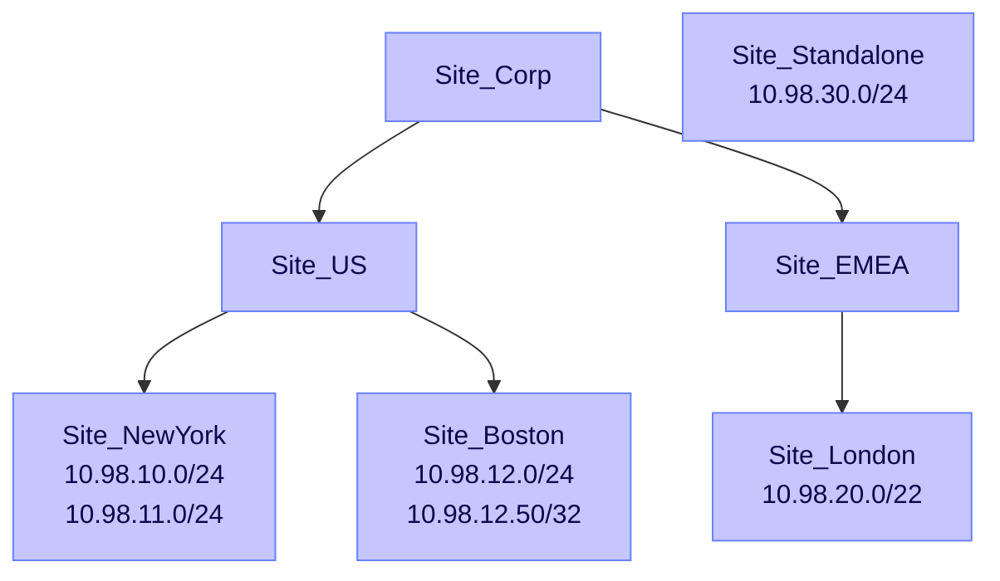

# Site hierarchy map

- **Generated:** 2026-11-04 10:00:00
- **Tenant:** mycompany-admin.zeronetworks.com
- **CSV file:** site-groups.csv
- **Mode:** Dry run preview
- **Groups:** 7
- **Subnets:** 6
- **Max depth:** 3 level(s)

## Graph (Mermaid)



## Tree

```text
Site_Corp  (0 subnets)  [Planned]
├── Site_US  (0 subnets)  [Planned]
│   ├── Site_NewYork  (2 subnets)  [Planned]
│   └── Site_Boston  (2 subnets)  [Planned]
└── Site_EMEA  (0 subnets)  [Planned]
    └── Site_London  (1 subnet)  [Planned]
Site_Standalone  (1 subnet)  [Planned]
```

## Table

| Group | Parent | Level | Status | Subnet count | Subnets |
|---|---|---|---|---|---|
| Site_Corp | - | 1 | Planned | 0 | - |
| Site_US | Site_Corp | 2 | Planned | 0 | - |
| Site_EMEA | Site_Corp | 2 | Planned | 0 | - |
| Site_NewYork | Site_US | 3 | Planned | 2 | 10.98.10.0/24, 10.98.11.0/24 |
| Site_Boston | Site_US | 3 | Planned | 2 | 10.98.12.0/24, 10.98.12.50/32 |
| Site_London | Site_EMEA | 3 | Planned | 1 | 10.98.20.0/22 |
| Site_Standalone | - | 1 | Planned | 1 | 10.98.30.0/24 |

> **Reminder:** Zero Networks must enable Sites after these groups exist.
